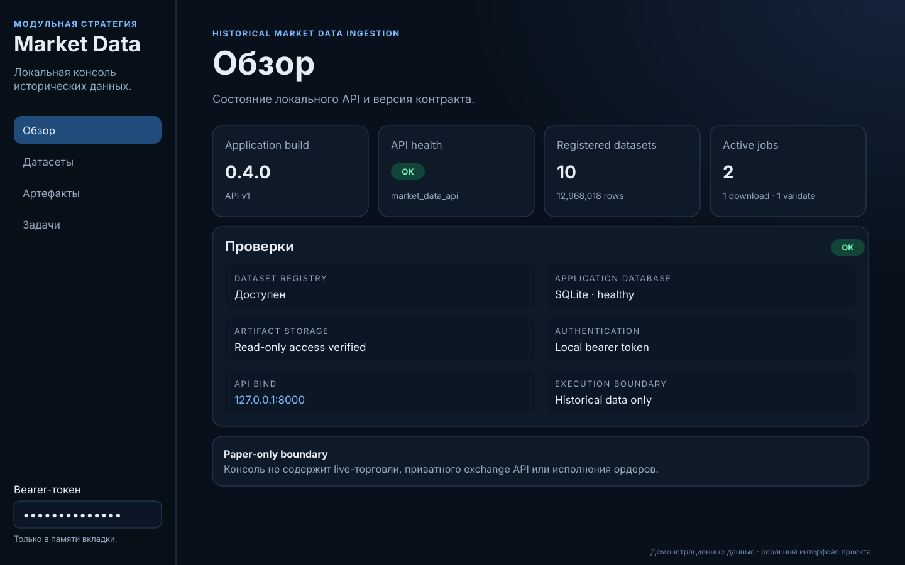
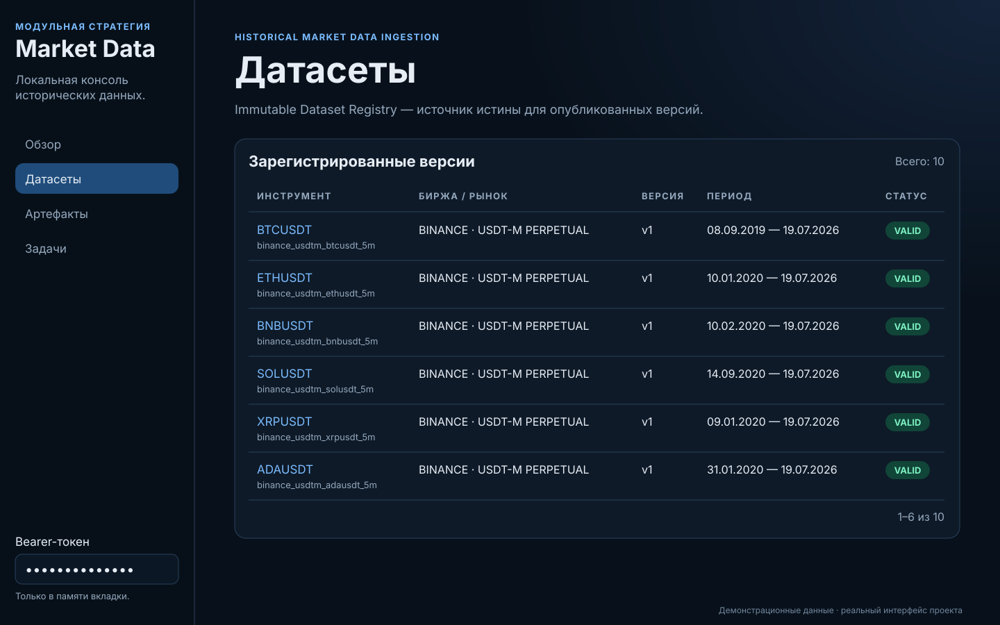
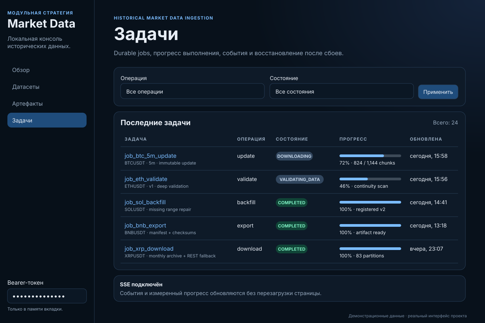
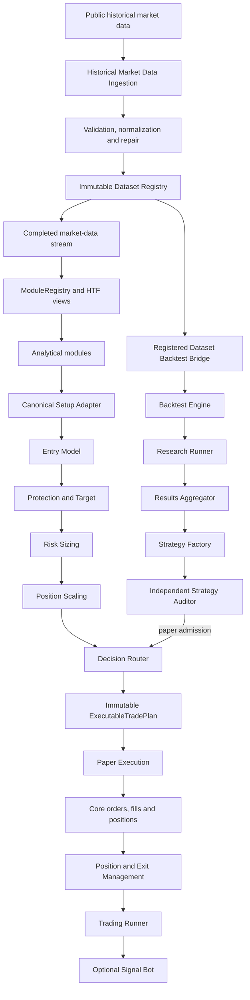

<div align="center">

# Модульная Стратегия

### Детерминированная платформа для исторических данных, исследования торговых стратегий, воспроизводимых бэктестов и контролируемого paper-исполнения

**Python 3.12 / 3.13 · Event-driven Core · Immutable evidence · Paper only**

</div>



> [!IMPORTANT]
> Проект находится в режиме **paper-only**. Репозиторий не разрешает live-торговлю, не содержит одобренного пути для приватных ключей биржи, подписи торговых запросов, реального размещения ордеров или изменения настоящего портфеля.

## О проекте

**Модульная Стратегия** — это monorepo для построения и проверки алгоритмических торговых систем без смешивания аналитики, риск-логики, исполнения и аудита в один неуправляемый движок.

Платформа объединяет полный воспроизводимый цикл:

```text
исторические данные
→ валидация и неизменяемая регистрация
→ модульный анализ рынка
→ построение торгового плана
→ детерминированный бэктест
→ исследование и сравнение кандидатов
→ независимый аудит
→ контролируемое paper-исполнение
→ восстановление, аудит и уведомления
```

Главная архитектурная идея проекта — **один ответственный компонент на каждую границу**. Аналитические модули не исполняют сделки, Strategy Factory не может самостоятельно разрешить стратегию, Signal Bot не является вторым торговым движком, а Paper Execution не пересчитывает решения Router.

## Текущее состояние

| Параметр | Актуальное состояние |
|---|---|
| Работа | Локальная подготовка нового корня; проверка assembled-копии продолжается |
| Идентичность нового корня | Локальный Git HEAD после фиксации; история новая, release acceptance отсутствует |
| Историческая база | Интеграционный checkpoint 127c483 — только архивный reference, не текущий HEAD и не идентичность нового корня |
| Frozen Core | modular-strategy-core 0.4.2 остаётся нормативным контрактом; это не подтверждение принятия нового корня |
| Поддержка Python | 3.12 и 3.13 — целевые версии; итоговая проверка нового корня продолжается |
| Релиз и CI | Нет release acceptance или новых CI-проходов; проверки исходных refs и receipts не перенесены |
| Публикация | Публичное назначение не выбрано и не создано; разрешения на публикацию или удалённые записи нет |
| Исполнение | Только paper-профиль; операционный PAPER закрыт, live execution запрещён |

Исходный репозиторий остаётся частным архивом. Новая assembled-копия — отдельная
локальная source identity, идентифицируемая своим Git HEAD после фиксации.
Локальная реализация и синтетические проверки разрешены; их текущий статус —
verification in progress, а не release acceptance. Исторические ветки, PR,
issues, CI результаты, grants и receipts служат только архивными ссылками.

Состав нового корня сохраняет все 26 Python distributions и Web Console.
Нормативные продуктовые решения:

- Сохраняются три стратегии: breakout_return, fvg_rt с явной семантикой FVG-retest и liquidity_sweep. Сравнение кандидатов нейтральное; независимый аудит обязателен до PAPER.
- #933 выбран как будущий единый владелец PAPER accounting в Core SQLite. Локальная реализация разрешена; операционный PAPER остаётся закрытым до появления авторитетной identity/writer, capital и risk limits, источников order/position/terminal/reconciliation/protection и миграции populated state.
- #396 задаёт общий детерминированный capital pool: независимые позиции по стратегиям, порядок priority затем стабильный instanceID, полный отказ запроса при нехватке капитала и durable reservations до авторитетного terminal outcome или reconciled recovery.
- #395 задаёт durable Strategy Lifecycle owner и поколения Core SQLite с multi-instance identity/recovery. SUSPEND закрывает новый риск и переводит неоднозначное состояние в quarantine; остаются только подтверждённые position-level protective actions. RESUME — только явное действие оператора после свежей проверки plan, data и protection.
- Linux является операционной целевой платформой; Darwin acceptance обязателен отдельно на той же точной source identity. Обе acceptance пока не заявлены.
- MDI startup authentication обязательна. Signal Bot остаётся необязательным и только уведомительным. Option 3 controller/publisher не получает фактическую торговую или owner-data authority.
- Исторические market-dataset counts принадлежат частному архиву и не являются принятыми данными или acceptance нового корня.

Исторические материалы о full-RC и release readiness не удостоверяют готовность
этой копии. См. [дорожную карту](ROADMAP.md), [критический путь](.github/HQ_CRITICAL_PATH.md)
и [архивный аудит релизной готовности](docs/audits/RELEASE_READINESS_2026-10-02.md)
как контекст; они не заменяют привязанные к новому корню gates.

## Интерфейсы

В проекте реализована локальная read-only **Market Data Web Console** на React. Она работает поверх loopback-only FastAPI и предназначена для просмотра состояния API, зарегистрированных датасетов, immutable-артефактов, durable jobs, прогресса и событий.

> [!NOTE]
> На изображениях используются демонстрационные записи. Компоновка, разделы, визуальный стиль и элементы интерфейса соответствуют реальной Web Console из `web/market-data-console`. SVG-иллюстрации подготовлены специально для README и не являются снимками production-окружения.

### Обзор системы


Экран показывает версию приложения, health локального API, число зарегистрированных датасетов, активные задачи и состояние внутренних хранилищ.

### Immutable Dataset Registry



Интерфейс отображает точную зарегистрированную версию, инструмент, биржу, рынок, временной диапазон, validation status и immutable identity датасета.

### Durable jobs и измеренный прогресс



Задачи поддерживают фильтрацию по операции и состоянию, измеренный progress, durable event history и SSE-обновления без перезагрузки страницы.

Текущий Web Console scope:

- API version и health;
- список Dataset Registry и просмотр точной версии;
- поиск immutable artifact по публичному ID;
- авторизованная загрузка проверенного ZIP-артефакта;
- durable jobs с пагинацией и фильтрами;
- request/result/error/warnings/progress для отдельной задачи;
- bounded event timeline;
- bearer token только в памяти текущей вкладки;
- fetch-SSE reconnect с `Last-Event-ID`;
- автоматическая остановка активного stream при смене route или token.

Консоль не предоставляет формы удалённого исполнения, live-торговли или управления настоящими биржевыми позициями.

## Сквозная архитектура



Core не содержит ветвлений под конкретные стратегии. Модули подключаются через публичные контракты и entry points, не заменяя event loop, broker simulation, fill ledger, position accounting или audit journal.

## Слои платформы

### 1. Исторические данные

**Historical Market Data Ingestion** отвечает за:

- получение Binance Spot и USD-M исторических данных;
- официальные monthly archives и контролируемый REST fallback;
- UTC normalization;
- schema и instrument identity;
- duplicate/gap/continuity validation;
- bounded-memory spool;
- deterministic repair и backfill;
- CSV/Parquet publication;
- immutable manifest и dataset hash;
- Dataset Registry;
- durable jobs, recovery и measured progress;
- локальные CLI, FastAPI и Web Console.

Идентичность зарегистрированных данных:

```text
dataset_id + dataset_version + dataset_hash
```

Изменённые байты, несовместимая схема, неверный manifest, конфликт версии или повреждённая lineage приводят к fail-closed отказу.

### 2. Детерминированное ядро

**Core 0.4.2** владеет универсальными контрактами:

- Module API и module lifecycle;
- dependency planning;
- Feature Store;
- completed timeframe aggregation;
- setup lifecycle;
- orders, partial fills и fills;
- positions и accounting;
- event envelopes и event stores;
- checkpoints и deterministic recovery;
- run identity и reproducibility evidence;
- time/session/calendar boundaries;
- exchange rules и instrument precision.

Frozen contract snapshot фиксирует публичные exports, ключевые DTO, enums и signatures. Изменение Core после freeze допускается только для воспроизведённого integration/recovery defect с полным replacement evidence.

### 3. Аналитические модули

В full-RC входят:

- Session Range;
- Market Regime;
- Fibonacci;
- Fair Value Gap;
- Breakout–Return;
- Wave Analysis;
- Liquidity Sweep;
- Canonical Setup Adapter.

Аналитические модули публикуют features и setups. Они не размещают заявки, не рассчитывают окончательное исполнение и не изменяют portfolio state.

### 4. Построение торгового решения

Исполняемая цепочка включает:

- Entry Model;
- Protection & Target;
- Risk & Position Sizing;
- Position Scaling & Adjustment;
- Decision Router & Trade Plan Composer.

Результатом является immutable `ExecutableTradePlan`, содержащий точную identity, параметры, OCC evidence, validity interval и hashes. Downstream-компоненты не имеют права молча пересчитывать его содержание.

### 5. Исследовательская платформа

**Backtest Engine** использует Core как единственный источник execution semantics.

**Research Runner** отвечает за:

- deterministic experiment specifications;
- grid/random/staged planning;
- train/validation/test/OOS разделение;
- durable scheduling;
- leases, fencing, retries и recovery;
- immutable result publication;
- reproducible execution across processes.

**Results Aggregator** проверяет и регистрирует evidence packages без повторного расчёта producer metrics.

**Strategy Factory** создаёт и исследует кандидатов, но не может авторизовать их самостоятельно.

**Strategy Audit & Validation** является независимым authority для paper admission. Auditor не содержит live authorization enum, private credentials или order-placement path.

### 6. Paper execution

**Paper Execution & Venue Reconciliation** принимает только валидный Router envelope и обеспечивает:

- market/limit/stop/stop-limit/take-profit lifecycle;
- partial fills;
- cancellation и expiry;
- synthetic OCO;
- deferred protection;
- replay idempotency;
- conflicting-content rejection;
- blocked scopes;
- transactional recovery;
- order/position reconciliation.

**Position & Exit Management** управляет сопровождением уже принятой позиции.

**Trading Runner** является единственным runtime orchestrator и владеет startup, market-event ingestion, checkpoint ordering, recovery gates, supervision и controlled shutdown.

**Signal Bot** только публикует уведомления и не является альтернативным execution engine.

## Ключевые гарантии

### Point-in-time корректность

- timestamps timezone-aware и нормализованы в UTC;
- решения используют только завершённые candles;
- HTF публикуются только после полного закрытия;
- confirmation candle не может исполнять собственный сигнал;
- gap и out-of-order paths обрабатываются явно;
- no-look-ahead проверяется контрактами и тестами.

### Детерминизм

Одинаковые данные, конфигурация, версии модулей и seed должны формировать одинаковую identity и эквивалентное evidence. Recovery сравнивается с непрерывным выполнением.

### Immutable lineage

Dataset, backtest run, experiment, strategy candidate, audit decision и executable plan связываются content-addressed hashes. Неполная или изменившаяся lineage не считается доверенной.

### Fail-closed поведение

До side effects система отклоняет:

- incompatible Module API;
- invalid/unknown parameters;
- duplicate module names или feature producers;
- missing dependencies и dependency cycles;
- malformed market data;
- corrupted artifacts;
- stale или tampered plans;
- invalid checkpoint state;
- unauthorized execution mode;
- dataset identity conflict;
- incomplete audit evidence.

### Единственный владелец каждой границы

| Граница | Ответственный компонент |
|---|---|
| Generic lifecycle, events, orders, fills, positions | Core |
| Acquisition, validation, repair, Dataset Registry | Market Data Ingestion |
| Historical execution modelling | Backtest Engine |
| Experiment planning и execution | Research Runner |
| Immutable experiment evidence | Results Aggregator |
| Candidate generation | Strategy Factory |
| Paper admission | Independent Strategy Auditor |
| Executable trade plan | Decision Router |
| Paper-plan execution и reconciliation | Paper Execution |
| Runtime orchestration | Trading Runner |
| Notifications | Signal Bot |

## Быстрый старт

### Требования

- Python 3.12 или 3.13;
- Git;
- Node.js 22.12+ только для Market Data Web Console;
- `pyarrow` для Parquet paths;
- зависимости конкретного компонента для его focused validation.

### Корневое окружение

```bash
git clone https://github.com/MishkaStrategy/Module-Strategy.git
cd Module-Strategy

python3.12 -m venv .venv
source .venv/bin/activate

python -m pip install --upgrade pip
python -m pip install -e '.[dev,backtest,signal-bot]'
python -m pip check
```

Доступные root entry points:

```bash
modular-backtest --help
modular-signal-bot --help
```

### Market Data backend и API

```bash
python -m pip install -e './modules/market_data_ingestion[parquet,interface,dev]'

market-data --help
market-data-v1 --help
market-data-v1-migrate --help
market-data-api --help
```

Market Data API рассчитан на локальный loopback bind. Перед первым запуском проверьте параметры через `market-data-api --help` и не открывайте интерфейс наружу без отдельного security/deployment решения.

### Market Data Web Console

API должен работать на `127.0.0.1:8000`.

```bash
cd web/market-data-console
npm ci
npm run typecheck
npm test
npm run dev
```

Vite запускается на `127.0.0.1:5173` и проксирует `/api` только на валидированный loopback target.

Production-like static build для локальной проверки:

```bash
npm run build
npm run preview
```

External hosting и remote bind этим проектом не авторизованы.

### Тесты

Корневой smoke:

```bash
python -m pytest -q
```

Отдельные компоненты имеют собственные `pyproject.toml`, dependency groups, README и CI workflows. Для release evidence авторитетны команды permanent workflow конкретного компонента, а не одна универсальная локальная команда.

## Структура репозитория

```text
Module-Strategy/
├── src/                         Core, Backtest Engine и root packages
├── modules/                     Изолированные analytical/application packages
├── plugins/                     Plugin packages, включая FVG
├── applications/                Runtime applications, включая Trading Runner
├── web/market-data-console/     React Web Console
├── config/                      Machine-readable configuration
├── benchmarks/                  Performance, memory и reproducibility harnesses
├── scripts/                     Audit, CI и operational utilities
├── docs/                        Architecture, audits, ledgers и handoffs
├── tests/                       Root contracts и integration tests
└── .github/workflows/           Component, policy, integration и acceptance CI
```

## CI и воспроизводимость

Проверки маршрутизируются на self-hosted runners по capability labels, а не по имени машины:

```text
[self-hosted, fast]
[self-hosted, backtester]
[self-hosted, docker]
[self-hosted, macos]
```

В зависимости от компонента CI включает:

- exact-head fencing;
- compile/import validation;
- Ruff lint и format;
- strict MyPy;
- isolated pytest suites;
- branch-aware coverage;
- deterministic replay/restart;
- memory и performance guards;
- wheel/sdist build;
- clean-install smoke;
- Bandit, detect-secrets и pip-audit;
- SBOM;
- artifact inventory и SHA-256 verification;
- browser E2E;
- persistent Dataset Registry smoke;
- full-RC release-readiness audit.

Новый commit на release-candidate автоматически инвалидирует старое exact-head evidence и требует повторного прохождения затронутых gates.

## Активные направления оптимизации

Следующие изменения изолированы в Draft PR и не являются автоматически принятой частью full-RC:

| PR | Направление | Граница |
|---:|---|---|
| [#288](https://github.com/MishkaStrategy/Module-Strategy/pull/288) | Project-wide optimization audit | Только evidence и backlog |
| [#287](https://github.com/MishkaStrategy/Module-Strategy/pull/287) | Bounded-memory Backtest/Core | P0 memory remediation |
| [#290](https://github.com/MishkaStrategy/Module-Strategy/pull/290) | Historical ingestion I/O | Ingestion only |
| [#289](https://github.com/MishkaStrategy/Module-Strategy/pull/289) | Test architecture и isolation | Test infrastructure |
| [#291](https://github.com/MishkaStrategy/Module-Strategy/pull/291) | GitHub Actions optimization | CI/CD only |
| [#292](https://github.com/MishkaStrategy/Module-Strategy/pull/292) | Registered Dataset streaming adapter | Explicit opt-in |
| [#294](https://github.com/MishkaStrategy/Module-Strategy/pull/294) | Bounded Backtest + streaming integration | Temporary validation PR |

Ни один optimization PR не разрешён к автоматическому merge. Изменения должны сохранять trading semantics, dataset identity, audit evidence и paper-only boundary.

## Известные ограничения

- multi-strategy beta и stable operational PAPER release ещё не приняты;
- full-RC ещё не объединён с `main`;
- live exchange adapter и private request signing отсутствуют;
- внешнее размещение Market Data API/Web Console не разрешено;
- real-venue recovery и ambiguous-outcome reconciliation не реализованы как production path;
- production secrets provisioning и rotation не настроены;
- нет утверждённой production strategy;
- exchange-specific latency, funding, liquidity, rate limits и precision требуют отдельной валидации;
- long-duration staging soak не заменяется unit/integration tests;
- checkpoint и canonical evidence могут расти вместе с реальной торговой активностью;
- OHLC simulation не восстанавливает истинный intrabar path или order book.

## Безопасность и границы использования

Проект нельзя использовать как основание для live deployment только потому, что тесты зелёные. До любого production/live перехода необходимы отдельные решения по:

- external network boundary и TLS;
- trusted proxy policy;
- secrets management;
- kill switch;
- exchange authentication;
- real-position reconciliation;
- monitoring, alerting и SLO;
- incident response;
- deployment и rollback;
- independent human approval;
- strategy acceptance на untouched OOS и staging evidence.

## Каноническая документация

- [`ROADMAP.md`](ROADMAP.md) — текущая цель beta, milestones и дальнейший operational PAPER release;
- [`.github/HQ_CRITICAL_PATH.md`](.github/HQ_CRITICAL_PATH.md) — проверенный snapshot, блокеры и execution boundaries;
- [`PROJECT_STATE.yaml`](PROJECT_STATE.yaml) — machine-readable HQ state; generated summary не редактируется вручную;
- [`docs/audits/RELEASE_READINESS_2026-10-02.md`](docs/audits/RELEASE_READINESS_2026-10-02.md) — аудит, evidence и пределы проверки;
- [`docs/integration/FULL_PROJECT_INTEGRATION_LEDGER.md`](docs/integration/FULL_PROJECT_INTEGRATION_LEDGER.md) — ownership, integration history и release rules;
- [`docs/integration/FULL_RC_ACCEPTANCE_CHECKPOINT_2026-07-31.md`](docs/integration/FULL_RC_ACCEPTANCE_CHECKPOINT_2026-07-31.md) — принятый full-RC checkpoint;
- [`docs/FINAL_INTEGRATION_AUDIT.md`](docs/FINAL_INTEGRATION_AUDIT.md) — аудит детерминированной v0.6 integration;
- [`RELEASE_CHECKLIST.md`](RELEASE_CHECKLIST.md) — acceptance первого multi-strategy beta и дополнение для operational PAPER release;
- [`modules/market_data_ingestion/README.md`](modules/market_data_ingestion/README.md) — ingestion и Dataset Registry;
- [`web/market-data-console/README.md`](web/market-data-console/README.md) — локальная React Console;
- component README и architecture документы внутри `modules/`, `plugins/`, `applications/` и `docs/`.

## Governance

Изменения full-RC ограничены согласованным multi-strategy scope. Без отдельной явной авторизации запрещено:

- возобновлять закрытый исторический PR #265 или остановленную successor-линию #938;
- объединять full-RC с `main`;
- включать auto-merge;
- выполнять force-push, rebase или squash integration history;
- создавать stable tag или GitHub Release;
- публиковать packages;
- развёртывать сервисы;
- открывать Market Data API наружу;
- добавлять приватные exchange credentials;
- активировать live order placement;
- изменять реальный portfolio state.

Для принятой интеграции используются обычные history-preserving merge commits. Формальное human approval и отдельное governance decision обязательны перед любым release transition.

---

<div align="center">

**Modular Strategy — reproducible research first, execution only after independent evidence.**

</div>
