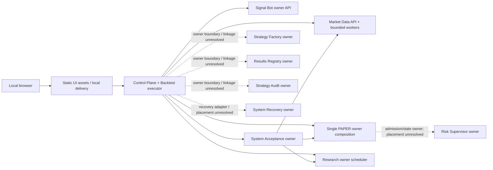

# Single-host PAPER topology proposal

**Status: draft for owner review; not an accepted deployment topology.** This document advances
[Issue #400](https://github.com/MishkaStrategy/Module-Strategy/issues/400), which has no accepted
topology; this proposal does not claim #400 acceptance. It preserves the full promised PAPER product scope and records concrete owner decisions
and evidence still needed. The selected logical profile separates Linux/VDS PAPER deployment,
mandatory Darwin acceptance, and the historical backtester. This selection does not establish
support or acceptance for any concrete host. It does not select a distro/image, architecture,
systemd baseline, real host paths, accounts, permissions, ports beyond source defaults, or a
supported operating-system matrix.

## Source facts

- Stage-1 is a reproducible, PAPER-only service-manager composition for the baseline two-hour
  System Acceptance phase. Its deployment entrypoint receives already-owned Market Data, Backtest,
  Research, Strategy Factory and Trading Runner objects, and keeps private roots, state paths,
  credentials and tokens on the trusted deployment side. It is not a full-product installer or
  topology. [Stage-1 deployment bindings](../system_acceptance/STAGE1_DEPLOYMENT_BINDINGS_V1.md#L1)
  [Trusted deployment boundary](../system_acceptance/STAGE1_DEPLOYMENT_BINDINGS_V1.md#L34)
- The Stage-1 Mac service manager reconstructs Trading Runner, System Acceptance and an already
  prepared Research experiment, exposing the owner transports at `127.0.0.1:8780`, `:8781` and
  `:8782`. It closes them in reverse order. It starts Trading Runner before constructing the
  Stage-1 prestart proof, so this composition cannot serve as a read-only preflight for a full
  product startup. [Stage-1 lifecycle](../system_acceptance/STAGE1_MAC_RESTART_HANDOFF_V1.md#L67)
  [Current startup implementation](../../scripts/system_acceptance_stage1_service_manager.py#L139)
- Stage-1 uses the prepared Research identity and does not call `ResearchRunner.prepare()` while
  materializing acceptance. This proves a prepared-owner attachment, not the full-product Research
  scheduler/recovery lifecycle. [Prepared Research binding](../system_acceptance/STAGE1_DEPLOYMENT_BINDINGS_V1.md#L220)
- Stage-1's frozen acceptance identity is stricter than a source commit or a healthy endpoint: it
  includes the versioned owner-contract set, a deeply revalidated registered-dataset identity
  (`descriptor.dataset_hash`, not a raw file/archive hash), the verified PAPER Strategy Package,
  Backtest execution identity, prepared Research experiment ID plus specification fingerprint, and
  the PAPER runtime/configuration identity. The composition rejects drift against this material
  before production bindings are used. These are the existing two-hour Stage-1 identity rules; they
  are a useful baseline for the full profile, not a substitute for the accepted #387 candidate and
  profile contract. [Stage-1 owner contract identity](../system_acceptance/STAGE1_DEPLOYMENT_BINDINGS_V1.md#L56)
  [Registered dataset identity](../system_acceptance/STAGE1_DEPLOYMENT_BINDINGS_V1.md#L88)
  [Verified PAPER Strategy Package](../system_acceptance/STAGE1_DEPLOYMENT_BINDINGS_V1.md#L107)
  [Frozen Research identity](../system_acceptance/STAGE1_DEPLOYMENT_BINDINGS_V1.md#L216)
  [PAPER runtime identity](../system_acceptance/STAGE1_DEPLOYMENT_BINDINGS_V1.md#L237)
- Market Data bounds its in-process job executor with `worker_count` (default 2, configured range
  1–32). Its API recovers jobs during application lifespan and binds only to loopback. These are
  component facts; they do not define full-host concurrency, firewall or egress policy.
  [Market Data settings](../../modules/market_data_ingestion/src/market_data_application/settings.py#L19)
  [In-process workers](../../modules/market_data_ingestion/src/market_data_application/application.py#L82)
- [API recovery](../../modules/market_data_ingestion/src/market_data_application/server.py#L70)
  [Loopback bind validation](../../modules/market_data_ingestion/src/market_data_application/server.py#L85)
- The Control Plane has a loopback default and an existing Backtest executor/store composition. Its
  Backtest output/state paths have source defaults, while most other owner attachment paths are
  deployment-provided. [Control Plane loopback default](../../applications/control_plane/src/modular_control_plane/server.py#L85)
  [Backtest path defaults](../../applications/control_plane/src/modular_control_plane/server.py#L105)
  [Backtest composition](../../applications/control_plane/src/modular_control_plane/server.py#L412)
- The existing Control UI covers Market Data, Backtest, Research, evidence, PAPER runtime,
  System Acceptance and Signal Bot surfaces. It is owner-backed and local/PAPER-only; it does not
  read arbitrary filesystem paths or run arbitrary commands. [Control UI accepted surfaces](../control_ui/README.md#L50)
- Component listener defaults currently include Control Plane `127.0.0.1:8765`, Market Data
  `127.0.0.1:8000`, Signal Bot health/metrics `127.0.0.1:8080`, Signal Bot operator control
  `127.0.0.1:8081`, and the Stage-1 transports above. Signal Bot health CLI overrides do not enforce
  loopback, so a full profile must validate or constrain that bind separately. The source inventory
  explicitly says these are not an accepted firewall or whole-product port contract. That inventory
  is a local HQ planning note, not evidence from the exact source tree. [Local HQ listener inventory
  (not source evidence)](README.md)
- Durable owner paths are only partly configured. The current inventory identifies constructor,
  CLI and environment inputs but no accepted product-wide root, owner account, ACL or effective
  umask. [Storage ownership inventory](STORAGE_OWNERSHIP_INVENTORY.md#L339)
- System Recovery #377 provides an accepted typed package/restore owner contract and manual
  operator runbook. It requires owner-native reopen/reconciliation and does not authorize pruning.
  The bounded named recovery-plan/profile service and Control Plane adapter remain open under #778.
  [Typed package service](../../applications/system_recovery/RUNBOOK.md#L62)
  [Clean-root restore and owner reopen/reconciliation](../../applications/system_recovery/RUNBOOK.md#L140)
  [Recovery/pruning boundary](BACKUP_DEPENDENT_PRUNING_ADMISSION.md#L163)
- The linked release reconciliation is a local HQ planning note, not source evidence from exact tree
  `8e8d0f303712a2afa926e6f0b3e19659e2d57b3d` and not release acceptance. It records that there is
  no accepted whole-product Python lock/profile;
  existing candidate work does not prove full mixed Python/Web Console reconstruction, upgrade,
  rollback or host acceptance. [Local HQ planning note (not source evidence): #387 reconciliation](../release/RELEASE_LIFECYCLE_CURRENT_BASE_RECONCILIATION.md#L36)
  [Local HQ planning note (not source evidence): required release work](../release/RELEASE_LIFECYCLE_CURRENT_BASE_RECONCILIATION.md#L42)

## Recommended full PAPER profile

Use the macOS launchd Stage-1 composition as the best-evidenced lifecycle reference, while keeping
the selected Linux/VDS PAPER deployment, separate mandatory Darwin acceptance, and separate
historical backtester as distinct environment roles. Extend the deployment profile to one complete
local topology only after owner review. The role selection does not establish Linux/VDS support or
acceptance. Do not call Stage-1 alone the product topology or reduce the promised scope to make its
current composition appear complete.

The supported profile must include all of these capabilities:

1. Market Data API, durable registry/storage and its bounded in-process workers.
2. One authoritative PAPER owner composition: one Trading Runner/Core/Paper Execution runtime,
   with the already-owned modules, checkpoints, journals, OMS state and reconciliation gates.
3. The Control Plane with its existing Backtest executor and typed owner adapters.
4. The Research owner scheduler, durable experiment identity and recovery path, not only an
   already-prepared Stage-1 transport.
5. Signal Bot with its own state/config/replay gates and owner-only delivery ledger.
6. Static Web Console/Control UI assets built and bound to the exact release candidate, served
   locally through a delivery mechanism explicitly selected by the owner.
7. System Acceptance as the candidate-bound acceptance/soak owner where the selected profile
   requires it; it must bind to the same frozen PAPER identity as the runtime it evaluates.
8. Risk Supervisor's source-defined fail-closed new-exposure admission and durable safety state,
   with owner-native recovery, plus read-only Observability projection and evidence-based readiness.
   Missing or invalid required owner state must remain blocked/unavailable; process, API and path
   placement remain unresolved. [Risk Supervisor boundary](../../applications/risk_supervisor/README.md#L30)
   [Observability health](../control_ui/OBSERVABILITY_V1.md#L48)

Keep each authoritative durable owner in its own process boundary where an owner transport exists;
do not add generic queues, distributed coordination, active/active owners or shared writable SQLite
to solve local lifecycle needs. Use typed owner APIs and existing bounded worker/scheduler contracts.
The exact process split and any in-process composition must be reviewed against owner contracts
before acceptance.

Strategy Factory, Results Registry, Strategy Audit and System Recovery remain distinct owner
boundaries; this diagram does not define new APIs, processes or transports for them. Their links to
the Control Plane and their in-process versus separate-process placement require owner review.
System Recovery's bounded recovery-plan/profile service and Control Plane adapter remain open
under #778. Deployment, Darwin acceptance and historical backtesting remain separate environment
roles; this topology does not make acceptance-only environments deployment or reconstruction
obligations.

Risk Supervisor remains a separate durable safety owner for its verdict, halt latches, guard counters,
replay identities and audit state. Its source-defined admission boundary blocks new exposure unless
the current decision is `HEALTHY`; unavailable, invalid, stale or uninitialized state fails closed
for new risk, while reduce/close/cancel/protection-repair actions remain available. Restore must
preserve durable HALT and counters, and readiness must account for the authoritative decision and
source identities. These are owner boundaries, not a process or path selection. [Risk Supervisor
ownership and fail-closed state](../../applications/risk_supervisor/README.md#L5)
[Admission and restore boundary](../../applications/risk_supervisor/README.md#L30)
[PAPER admission semantics](../../applications/risk_supervisor/README.md#L44)

Unified Observability's read-only projection is a source-defined #378 contract; its integration into
this full profile and its deployment/recovery readiness evidence remain unresolved. It may report
Risk Supervisor state but cannot authorize or recalculate owner transitions. No new projection API
or process is defined here. [Observability owner boundary](../control_ui/OBSERVABILITY_V1.md#L5)
[Risk Supervisor projection boundary](../../applications/risk_supervisor/README.md#L58)

All management and health listeners must bind to loopback only. The table below is a list of source
defaults to help reserve and test ports; it is not a final port map or firewall/egress contract.

| Surface | Source default | Proposal boundary |
| --- | --- | --- |
| Control Plane API | `127.0.0.1:8765` | Loopback only; exact selected port and collisions remain a profile input. |
| Market Data API | `127.0.0.1:8000` | Loopback only; in-process worker count is bounded by the existing setting. |
| Trading Runner / System Acceptance / Research Stage-1 transports | `127.0.0.1:8780` / `:8781` / `:8782` | Fixed for the existing Stage-1 composition only; not assumed to be the complete profile's transport map. |
| Signal Bot health/metrics | `127.0.0.1:8080` | Proposed loopback-only profile rule; current CLI override does not enforce this. |
| Signal Bot operator control | `127.0.0.1:8081` | Keep the current authenticated loopback-only rule. |
| Static UI delivery | Not specified by current topology sources | Owner must choose local serving/binding, origin and asset path; loopback only. |

Do not expose a public management surface or add a reverse proxy in this profile. Any future remote
access proposal needs a separate security and deployment decision.

## Private deployment manifest and storage

The release should consume a private, typed deployment manifest that binds one immutable candidate
and profile to symbolic storage identities and final absolute paths. This proposal uses symbols only;
it deliberately contains no actual host paths or account names.

The profile-level artifact/lock set must cover the repository's complete supported Python
distribution inventory, enabled strategy/module packages and the Web Console build/runtime
artifacts. A candidate hash alone does not prove inventory completeness or that the selected modules
form a functional PAPER composition. [Local HQ planning note (not source evidence): current inventory and #387 gaps](../release/RELEASE_LIFECYCLE_CURRENT_BASE_RECONCILIATION.md#L33)

| Owner | Symbolic root(s) to bind | Single writer and permitted readers |
| --- | --- | --- |
| Market Data | `${MS_ROOT}/market-data` | Market Data service owns registry/jobs/artifacts and bounded workers. Backtest/Research may read only registered immutable dataset identities; Control Plane reads through Market Data owner API. |
| Core / Paper / Trading Runner | `${MS_ROOT}/paper-owner` | One Trading Runner composition owns runtime/checkpoint/journal/OMS state. Control Plane and Acceptance use typed owner transports; no second runtime or direct database writer. |
| Research Runner | `${MS_ROOT}/research` | One scheduler/repository owner writes experiment state and protected artifacts. Control Plane and Acceptance use read/owner APIs. |
| Strategy Factory | `${MS_ROOT}/strategy-factory` | One Factory owner writes run checkpoints, decision log, idempotency and protected artifacts; Control Plane reads through its adapter. |
| System Acceptance | `${MS_ROOT}/acceptance` | One Acceptance process writes its run/check/audit SQLite state; Control Plane consumes the authenticated loopback API. |
| Results Registry | `${MS_ROOT}/results-registry` | One registry owner writes metadata and immutable blobs; Control Plane and Research use read-only/query contracts. |
| Strategy Audit | `${MS_ROOT}/strategy-audit` | One audit owner writes the SQLite evidence/decision chain; Control Plane reads through its evidence adapter. |
| Risk Supervisor | Owner-defined durable state root; path and process placement unresolved | Risk Supervisor owns its verdict, durable halt latches, guard counters, replay identities and audit trail; admission/readiness/restore follow its source-defined owner contract. |
| Signal Bot | `${MS_ROOT}/signal-bot` | One Bot process writes the lifecycle/outbox/cursor database and operator ledger; Control Plane uses the authenticated Bot API. |
| Control Plane Backtest | `${MS_ROOT}/control-plane-backtest` | Control Plane's existing executor owns its job database/output; the operator UI reads through the same Control Plane API. |
| Derived caches and temporary work | `${MS_CACHE_ROOT}/...`, `${MS_TMP_ROOT}/...` | Each consuming owner is the writer. Caches are rebuildable only when their source is authoritative; temporary work has bounded owner cleanup. Neither substitutes for durable evidence. |
| Recovery packages | `${MS_BACKUP_ROOT}/...` | System Recovery writes a new package; verification/restore consumers are read-only until a clean restore target is explicitly selected. Backup and restore locations must be private inputs. |

For every symbolic root, the manifest must bind: canonical final absolute path; owning service
identity; exactly one writer; named read-only consumers; directory and file modes; effective umask;
filesystem/mount assumptions; free-space thresholds; backup destination; retention class; secret
references; and whether the path may be restored or migrated. Values remain owner decisions and
must not be copied into public evidence. Current code-defined mode requests are component-specific
and are not a substitute for a host ACL; use the [storage inventory](STORAGE_OWNERSHIP_INVENTORY.md)
as input, not as a universal policy.

The manifest must reject path collisions, symlinked roots, writable overlap between owners,
unresolved symbolic roots, and undeclared consumers before starting any owner. Private absolute
paths stay out of browser requests, public acceptance material and sanitized evidence.

## Startup, readiness and shutdown proposal

1. **Static preflight, without starting owners:** load the exact candidate/profile manifest; verify
   all ecosystem lock and package/artifact identities, supported runtime, config digests, path/root
   type and ownership/mode expectations, secret references, free space, lock availability, port
   availability and the approved firewall/egress profile. Fail closed before opening listeners or
   mutating owner state. The Stage-1 manager currently starts Trading before it forms its prestart
   proof, so it cannot be reused as this read-only preflight.
2. **Recover source and research owners:** start Market Data under its own recovery gates, verify
   job/lease/repair state and registered dataset identity, then reconstruct the one Research
   scheduler against the same prepared experiment identity. A healthy port is not proof of either
   identity or recoverability.
3. **Recover the sole PAPER owner:** reconstruct exactly one runtime from the frozen candidate,
   runtime/configuration/portfolio/strategy identity, matching checkpoint and journal; reopen OMS
   and reconciliation state; keep new exposure blocked until recovery and reconciliation pass.
4. **Start acceptance and operator services only after owner gates:** System Acceptance receives
   typed deployment-owned bindings to the same dataset, research experiment, package and PAPER
   runtime identity. Start Control Plane and local static assets only after every required adapter
   reports both transport health and matching owner identity/capabilities. Start Signal Bot only
   after its own config, secret, database, replay/outbox and loopback gates pass.
5. **Readiness is semantic:** require verified source/release identity, owner-specific recovery
   proof, expected capabilities, loopback address, storage health and dependency agreement. A
   successful TCP connection, `/health` response or process-manager “running” state alone is
   insufficient.

On shutdown, stop new UI/Control Plane mutations and new exposure first; quiesce Market Data job
admission and Bot delivery; allow owners to drain or record explicit interruption; persist
checkpoint/journal/lease and acceptance progress through owner APIs; close UI/Control Plane and
owner transports; then close the authoritative owners in reverse documented startup order. Restart
must reconstruct the same frozen identities, not infer state from browser memory or reuse stale
process-local locks.

## Recovery, upgrade and rollback

- Reuse the closed #377 System Recovery package and owner-native manual runbook. Recovery requires a
  trusted manifest digest, clean restore roots, owner-native reopen, and PAPER reconciliation before
  new exposure. #778 remains an implementation gap for a bounded named recovery-plan/profile service
  and Control Plane adapter; this proposal does not claim that work is accepted. Keep arbitrary
  browser path input forbidden. [System Recovery procedure](../../applications/system_recovery/RUNBOOK.md)
  [#778 Control UI gap](../control_ui/OPERATIONS_RUNBOOK_V1.md#L265)
- Do not prune durable state as part of backup, upgrade or normal operation. Backup completion is
  separate from owner lifecycle authority to delete. [Pruning remains owner-gated](BACKUP_DEPENDENT_PRUNING_ADMISSION.md#L163)
- Bind lifecycle evidence to this proposed release-identity model intended to satisfy the official
  scope of [#387](https://github.com/MishkaStrategy/Module-Strategy/issues/387); this model is not an
  owner-accepted contract. The local HQ reconciliation note is planning-only and is not source
  evidence for the official #387 scope. The proposed canonical candidate ID
  binds source, package/build artifacts, locks, compatibility declarations, migration/rollback
  implementations and composition/configuration; the profile ID binds supported topology,
  capability matrix and acceptance policy. Evidence binds both. A final release envelope references
  the candidate, profile, accepted evidence and owner approval. Bind System Recovery manifests to
  the accepted release identifier using their `platform_release_id`, alongside `source_commit`; the
  restore owner checks the expected release identifier. This recovery identity does not replace the
  proposed #387 candidate/profile model. Do not invent semantics or substitute a host-local version label.
  [Recovery manifest contract](../../applications/system_recovery/RUNBOOK.md#L62)
- Issue [#390 / GAP-013](https://github.com/MishkaStrategy/Module-Strategy/issues/390) is **CLOSED**, but
  its storage/capacity acceptance is incomplete. The [storage inventory](STORAGE_OWNERSHIP_INVENTORY.md#L289)
  and [backup-dependent pruning admission](BACKUP_DEPENDENT_PRUNING_ADMISSION.md#L167) leave
  owner-specific retention/lifecycle rules, high/critical-water thresholds and quotas, low-disk/
  quota/read-only/interrupted-cleanup fail-safe behavior, approved bounded pruning, idempotent
  pruning audit evidence, and reconciliation with the accepted capacity forecast/System Resources
  consumer unresolved. Treat protected durable state as non-disposable until each concrete owner
  rule is accepted; do not present backup or this topology proposal as solving these gaps.
- Upgrade only from a complete predecessor candidate to a frozen target candidate whose profile,
  dependency locks, package artifacts, Web assets and migrations are all identity-bound. Record the
  predecessor and target candidate/profile identities and bind each upgrade result to that pair. Stage the
  immutable release beside the active one; verify it before switching; snapshot owner state; execute
  only declared, owner-reviewed migrations; then reopen owners and run health/identity/reconciliation
  gates.
- Rollback evidence must name the same predecessor/target candidate and profile identities and the
  resulting state identity. Roll back only when the predecessor can read the resulting state under a proven compatible schema
  and semantics. Otherwise restore the predecessor-bound snapshot to a clean root and run the full
  owner recovery/reconciliation path. Do not assume every migration is reversible or that a process
  symlink flip restores database state. #387 acceptance and owner review are prerequisites.

## Explicitly unsupported until separately approved

- Live trading, real orders, private exchange execution, or Live credentials;
- public management endpoints, unauthenticated proxying, or remote browser path inputs;
- multi-host, active/active ownership, shared writable SQLite, or generic queue/distributed
  infrastructure;
- arbitrary shell/command execution, arbitrary file reads, or browser-supplied filesystem paths;
- generic state pruning or deletion based on age/path/size;
- any OS/runtime/filesystem profile without explicit support-matrix and owner acceptance;
- rollback claims without predecessor compatibility or a proven clean-root restore.

## Owner decisions and current blockers

These are required inputs, not values this proposal invents:

- Concrete supported host and runtime matrix. Linux/VDS is the selected PAPER deployment role;
  Darwin acceptance is a separate mandatory role and historical backtesting is separate. The
  distro/image, architecture/libc, systemd baseline, host and runtime remain open, and this role
  selection does not establish deployment support or acceptance. macOS launchd remains the
  best-evidenced Stage-1 lifecycle reference.
- Exact full-product service/process composition and the local static asset server. Clean-host
  candidate acceptance is required evidence; whether System Acceptance runs continuously as a
  steady-state service or only as a candidate-gated service remains an owner decision.
- Final identities for service owners/readers, one-writer boundaries, directory/file modes, umask,
  firewall, outbound network/egress, bind/port assignments, restart and health deadlines.
- Private absolute storage roots, backup destination, filesystem/mount guarantees, capacity floors,
  ownership of secret references and recovery package custody.
- Accepted #387 candidate/profile locks and artifact identities; complete install/reconstruct,
  migration, upgrade and state-compatible rollback contract.
- The release predecessor and trust root are not selected, and GitHub Actions are disabled. Local
  checks and older CI runs are not acceptance. Re-enabling Actions and establishing an independent
  release-evidence producer/publisher remain owner/admin gates; this proposal authorizes neither.
- Full lifecycle/drift/portfolio coordination and operator contracts, including the open #396
  portfolio slice; Research scheduler recovery and one-PAPER-owner composition on a clean host.
- A/B and determinism evidence, soak policy, drift/readiness acceptance, and Recovery UI/CLI
  acceptance remain open wherever owner evidence is absent; this proposal sets no thresholds or policy.
- Host-level proof that install, permission denial, restore/reopen/reconcile, fault recovery and
  restart continuity work with sanitized, candidate-bound evidence.

## Environment-role owner review matrix

The matrix records proposed evidence obligations and current blockers for owner review. It selects
no platform tuple, process, path, threshold, or policy. Darwin acceptance and the historical
backtester are separate roles; they do not create deployment, build, or reconstruction obligations
for acceptance-only environments.

| Capability | Owner/state | Environment role | Candidate/profile identity | Required evidence | Current blocker |
| --- | --- | --- | --- | --- | --- |
| Full PAPER composition, including Risk Supervisor safety admission and Observability projection/readiness | Component owners remain authoritative; Risk Supervisor owns durable verdict/latches/counters/audit, Observability is read-only | Linux/VDS deployment | Proposed model binds exact candidate, profile and owner-state identities; contract not accepted | Clean-host candidate proof of owner recovery, semantic readiness, fail-closed new-risk admission, durable HALT restore, and read-only projection | Host/runtime tuple, #387 locks and identity contract, predecessor/trust root, Actions and owner/admin gates remain unresolved |
| Candidate acceptance across required owner surfaces | System Acceptance owns acceptance state and binds source-owner proofs | Separate mandatory Darwin acceptance | Must bind to exact candidate/profile under the proposed model; cross-role binding remains owner review | Candidate-bound Darwin acceptance, drift/readiness and recovery evidence for required owners | Supported Darwin tuple, acceptance policy, soak policy and owner approval remain open |
| Historical Backtest execution and result identity | Backtest/Research owner state; exact ownership relationship remains source-contract-defined | Separate historical backtester | Candidate/profile relationship and artifact identity contract remain unaccepted | Reproducible, candidate-bound historical run and result evidence; A/B and determinism gates only when owner-defined | Backtester profile, A/B policy, deterministic acceptance criteria and release identity remain open |
| New Research experiment creation, admission and recovery | Research specification/repository/scheduler own experiment identity and durable execution | Deployment role, with candidate-bound acceptance separately verified | Exact specification fingerprint and experiment identity bind to the proposed candidate/profile model | Prove new experiment creation/admission, scheduler execution, restart/recovery and stable owner identity; prepared Stage-1 attachment alone is insufficient | Clean-host scheduler lifecycle acceptance and its binding to #387 candidate/profile remain open ([Research flow](../research_runner/ARCHITECTURE.md#L22), [Stage-1 does not call `prepare()`](../system_acceptance/PRODUCTION_PHASE_BINDINGS_V1.md#L100)) |
| Risk Supervisor and Observability readiness/recovery | Risk Supervisor is authoritative for safety state; Observability projects source-defined component health | Full profile, exercised in deployment and acceptance roles | Bind both to the exact proposed candidate/profile and authoritative source-state identities | Unavailable/invalid/stale safety state blocks new exposure; restore preserves latches/counters; missing telemetry remains unavailable and projection cannot authorize | Integration, recovery proof and readiness evidence for the complete profile are not accepted ([Risk state](../../applications/risk_supervisor/README.md#L30), [Observability health](../control_ui/OBSERVABILITY_V1.md#L48)) |
| A/B/determinism, soak, drift/readiness, Recovery UI/CLI | Gate-specific owners and System Acceptance; ownership/policy mapping unresolved | Applicable role per gate; allocation unresolved | Candidate/profile binding required by the proposed model, details unaccepted | Owner-approved gate definitions and sanitized evidence, with no inferred threshold or acceptance from local/old CI | A/B/determinism, soak policy, drift/readiness and Recovery UI/CLI acceptance remain open |

## Acceptance evidence required before calling this topology supported

- Owner-reviewed support matrix and private manifest schema with every required symbolic root bound
  to a final path, service identity, writer/readers, modes, umask, backup destination and egress rule.
- Clean-host install of the exact release bundle from accepted Python and Web Console locks; verify
  every expected executable, owner package, static asset digest and migration identity.
- Negative permission tests proving undeclared writers/readers, symlinked roots, wrong owners/modes,
  missing secrets, lock conflicts, invalid identities, non-loopback binds and blocked egress fail
  before owner mutation.
- End-to-end proof of Market Data recovery/workers, one Research scheduler, exactly one PAPER owner,
  Backtest execution, Control UI static delivery, Signal Bot owner control and System Acceptance
  against the same candidate/profile identities.
- Full-profile Risk Supervisor and Observability evidence: source-state-bound fail-closed admission,
  durable HALT/counter restore, read-only projection, and semantic readiness that remains blocked or
  unavailable when required source health is absent. [Risk Supervisor boundary](../../applications/risk_supervisor/README.md#L30)
  [Observability contract](../control_ui/OBSERVABILITY_V1.md#L48)
- Research evidence must include new experiment creation/admission and scheduler recovery under the
  authoritative Research owner; attaching Stage-1's already-prepared experiment does not prove that
  lifecycle. [Research architecture](../research_runner/ARCHITECTURE.md#L22)
  [Stage-1 binding](../system_acceptance/PRODUCTION_PHASE_BINDINGS_V1.md#L100)
- Clean-root #377 backup/restore followed by owner-native reopen, Market Data/Research verification,
  PAPER checkpoint/journal/OMS verification and reconciliation before exposure. No pruning.
- Fault/restart scenarios for interrupted startup, owner crash, unavailable dependency, partial
  checkpoint/journal, stale lock, storage-full/read-only root, upgrade failure and compatible or
  restore-required rollback; demonstrate continuity without duplicate side effects.
- Sanitized evidence bound to exact source, profile, lock and artifact digests, host/runtime class,
  gate/scenario, producer/run/attempt and outcome. No private paths, accounts, tokens or raw owner
  payloads in public evidence.

## Issue #400 deliverable crosswalk

This crosswalk maps the 11 issue deliverables to reviewed local documents. “Documented” means the
stated boundary or procedure is present in those documents; it does not mean the topology or issue
has been accepted. Proposal text and acceptance criteria below remain proposed until owner review and
candidate-bound evidence exist. This table does not change any GitHub checkbox.

| Deliverable | Local evidence | Status | What would prove acceptance |
| --- | --- | --- | --- |
| 1. Supported single-host PAPER topology and unsupported variants | This proposal defines the full intended PAPER composition and unsupported modes ([profile](#recommended-full-paper-profile), [unsupported variants](#explicitly-unsupported-until-separately-approved)). | partial; owner decision | Owner-approved host/runtime support matrix, process topology, and unsupported-variant contract, bound to the accepted candidate/profile. |
| 2. Ownership/supervision for Market Data, Research, Trading Runner, Control Plane, Signal Bot, Risk Supervisor and Observability projection | Proposed owner boundaries and symbolic roots ([owner layout](#private-deployment-manifest-and-storage)); current Stage-1 manager only covers a bounded composition ([Stage-1 lifecycle](../system_acceptance/STAGE1_MAC_RESTART_HANDOFF_V1.md#L67)). | partial; owner decision | Accepted full-product supervisor/process plan proving one writer per durable owner, dependency order, health/restart handling, risk admission/readiness, and exact candidate identity. |
| 3. Loopback/listen and firewall assumptions | Component listener defaults and limitations are inventoried in the local HQ planning inventory, not as exact source-tree evidence ([local HQ operations inventory](README.md)); proposal distinguishes source defaults from firewall/egress policy ([listeners](#recommended-full-paper-profile)). | partial; owner decision | Owner-approved full port/bind map, non-loopback rejection, host firewall/egress rules, and negative evidence on the supported host. |
| 4. State/data/evidence/cache paths, ownership and permissions | Component-level roots and filesystem rules are mapped, with explicit missing host bindings ([storage inventory](STORAGE_OWNERSHIP_INVENTORY.md#L330), [proposal roots](#private-deployment-manifest-and-storage)). | partial; owner decision | Private deployment manifest binds final paths, service identities, writer/readers, modes, umask, mounts, backup destinations and recovery/retention classes; permission tests pass. |
| 5. Manifest/lock-based install and exact version verification | Control UI install instructions are component-specific ([runbook](../control_ui/OPERATIONS_RUNBOOK_V1.md#L22)); proposal requires exact candidate/profile and lock/artifact checks, while the local HQ planning note (not source evidence) records that whole-product locks/reconstruction remain unaccepted ([local HQ release-planning note](../release/RELEASE_LIFECYCLE_CURRENT_BASE_RECONCILIATION.md#L36)). | partial; acceptance evidence missing | Clean-host install of an accepted full Python/Web release bundle, with exact source/profile/lock/artifact/version verification and sanitized evidence. |
| 6. Deterministic startup/restart/shutdown and health gates | Full-product lifecycle is proposed here ([startup/readiness/shutdown](#startup-readiness-and-shutdown-proposal)); Stage-1 has a bounded implemented lifecycle ([Stage-1 lifecycle](../system_acceptance/STAGE1_MAC_RESTART_HANDOFF_V1.md#L67)). | partial; acceptance evidence missing | Exact-candidate fault/restart tests prove startup ordering, semantic readiness, owner recovery, shutdown, restart continuity and no duplicate effects on the supported host. |
| 7. Integration with clean-host restore #377 and retention/storage #390 | #377 manual clean-root restore and owner-native reconciliation are documented ([recovery runbook](../../applications/system_recovery/RUNBOOK.md#L140)); #390 storage inventory says retention/capacity acceptance remains incomplete ([remaining work](STORAGE_OWNERSHIP_INVENTORY.md#L287)). | partial; acceptance evidence missing | Candidate-bound clean-host restore/reopen/reconcile evidence, plus accepted owner-specific retention/storage rules. Backup alone must not authorize pruning. |
| 8. Upgrade/rollback using #387 identities | Candidate/profile-bound upgrade and state-compatible rollback are proposed ([upgrade/rollback](#recovery-upgrade-and-rollback)); this is conditional on accepted #387 identities. | partial; acceptance evidence missing | Accepted #387 candidate/profile and migration contract, then exact predecessor-to-target upgrade and rollback/restore evidence proving state compatibility. |
| 9. No secret values in examples | The reviewed proposal uses symbolic roots, not host paths/accounts ([symbolic roots](#private-deployment-manifest-and-storage)); reviewed Stage-1 docs keep private values out of sanitized material ([trusted boundary](../system_acceptance/STAGE1_DEPLOYMENT_BINDINGS_V1.md#L34), [recovery secret boundary](../../applications/system_recovery/RUNBOOK.md#L9)). | documented in reviewed documents only | Review all issue-scope operational examples and generated evidence for secret values; this crosswalk is not a repository-wide secret audit. |
| 10. Smoke on a clean supported host | Clean-host install and end-to-end smoke are acceptance criteria ([acceptance evidence](#acceptance-evidence-required-before-calling-this-topology-supported)); Stage-1's physical Mac acceptance is explicitly still pending ([Stage-1 boundary](../system_acceptance/STAGE1_MAC_RESTART_HANDOFF_V1.md#L98)). | acceptance evidence missing | A clean host matching the owner-approved support matrix completes install, full composition, health, recovery/restart smoke and sanitized exact-candidate evidence. **No clean-host full-product smoke has been accepted.** |
| 11. Operational PAPER separated from future Live scope | Proposal explicitly excludes Live, real orders and private exchange execution ([unsupported variants](#explicitly-unsupported-until-separately-approved)); the Control UI runbook also states PAPER/local-only and no Live toggle ([safety boundary](../control_ui/OPERATIONS_RUNBOOK_V1.md#L5)). | documented | Keep the PAPER-only restriction in the accepted support profile, deployment manifest and operator runbooks; any Live scope requires a separate owner decision and release contract. |

Until the support matrix, deployment manifest, #387 candidate, owner decisions and clean-host evidence
are accepted, this document remains a proposal and Issue #400 remains open.
