# External Execution Boundary V1

**Status:** selected architecture; repository-side contracts are under local implementation. This document is not proof that any controller, executor, publisher, runner group, or evidence store has been deployed or verified.

**Local integration proof:** the reference publisher can read a committed publication without repair, and a separate candidate-evidence bridge checks the exact committed receipt/output bytes against frozen candidate/profile identities and an explicit local workload/output mapping. The result deliberately reports `external_trust_established=false` and `acceptance_eligible=false`. Its configured-key signature check is cryptographic verification under local test/configured keys only; it does not authenticate provider observations, key custody, executor teardown, or a protected trust root. The manifest's accepted-decision gate remains fail-closed. This is a local wiring test, not deployment or acceptance evidence.

**Local fixed-workload planning contract:** `scripts/fixed_workload_planner.py` creates a deterministic plan from frozen candidate/profile inputs and a versioned workload inventory. It binds each workload to a Linux PAPER, Darwin acceptance, or separate historical-backtester environment, runtime/image/material/output digests, and resource/network policy references; every `operations:mac-service-reconnect` profile/workload scope must resolve to the same `acceptance_darwin` environment. It rejects missing acceptance-scope coverage and environment or gate-kind downgrades. Per-workload outputs follow the admission/receipt path contract: portable relative paths, a 256-output cap, case-insensitive collision checks and file/directory-prefix conflict rejection. The profile's single build/deployment environment remains unchanged; acceptance scopes map separately to workload environments. Inventory self-digests provide corruption detection only, not trusted provenance or proof of completeness. The planner has no ledger, dispatch, executor, signer, or publisher path and keeps all authorization/trust/acceptance results false. Its focused 34-test suite and static checks are local engineering evidence, not external boundary or product acceptance.

## Selected topology

PAPER deployment targets Linux/VDS. A separate Darwin environment is mandatory for the owner-native service-reconnect acceptance gate. Historical backtesting uses a third, separately provisioned node class. These are three environment identities with separate images, data access, and receipt coverage; a runner label alone does not establish that separation.

The project will not dispatch sensitive work directly from a candidate-controlled workflow. A protected external controller validates the candidate and a fixed workload policy, then issues one expiring, one-use admission. The executor is created for that admission, receives no GitHub write credential or signing key, checks out the exact source SHA with checkout credentials removed, and is destroyed when the job ends. No caller-supplied command, runner selector, data path, or resource limit can override the protected workload definition.

The controller observes the actual run, executor lifecycle, platform, exit status and output bytes, then signs a closed receipt. The executor cannot sign its own success. A separately operated publisher accepts only a valid controller receipt and matching content-addressed output bundle. It keeps an atomic ledger of consumed admission IDs, rejects stale or replayed receipts, and has the only credential that can publish release evidence. An independent verifier checks the signed receipt and complete required coverage before an owner can record acceptance.

```mermaid
flowchart LR
    Candidate[Candidate source SHA] --> Admission[Protected external admission controller]
    Policy[Protected workload policy and inventory] --> Admission
    Admission -->|one-use signed grant| Executor[Disposable isolated executor]
    Executor -->|candidate code; no write token or signing key| Result[Bounded outputs and terminal result]
    Result --> Controller[Controller observes run and executor lifecycle]
    Controller -->|controller-signed receipt| Publisher[Separate publisher and replay ledger]
    Result --> Publisher
    Publisher -->|append-only content-addressed evidence| Store[Restricted immutable evidence store]
    Store --> Verifier[Independent verifier]
    Verifier --> Owner[Owner decision for exact candidate and profile]
```

The figure distinguishes the executor from the actors that can authorize or publish. We should keep that separation even when a provider makes a same-workflow arrangement convenient: a candidate can modify its own workflow, so an in-repository `if` condition or an environment label cannot be the authority boundary. The protected controller must validate identity using provider-side job metadata and runner-manager observations, not fields echoed by candidate code.

## Required invariants

- Admission binds the canonical repository, full source commit, protected policy digest, fixed workload ID and digest, immutable toolchain/image digest, input/lock digests, environment identity, runtime, resource/network policy, unique admission ID and expiry.
- The controller derives required jobs from the protected inventory. The candidate cannot add a workload, skip a required one, weaken its environment, or select a host.
- Admission IDs are consumed atomically once. A retry gets a new admission and attempt; it cannot reuse an old grant.
- Executors are disposable and single-use. Candidate code cannot read controller signing keys, publisher credentials, or general-purpose owner secrets. Data access is read-only and scoped to the admitted workload. Network access is default-deny with explicit destinations when a workload requires them.
- A terminal receipt is signed by the trusted controller after it observes the source checkout, workload, executor identity/lifecycle, platform, timestamps, exit status and output payload digests. A receipt signed inside candidate-controlled execution is not trusted evidence.
- The publisher verifies the controller signature, policy and workload bindings, source and material digests, environment mapping, outcome and output bytes before publishing. It does not execute candidate helpers or check out candidate code. Existing content-addressed evidence is append-only; conflicting bytes fail closed.
- Linux deployment, Darwin acceptance and historical backtesting use separately identified node classes. Each required gate is matched to the environment declared for that gate; cross-environment evidence cannot substitute.
- Actions stay disabled until the external runner groups are repository-scoped, ephemeral execution and host teardown are demonstrated, controller and publisher identities are separated, and a negative admission/replay test suite passes.

## Repository implementation sequence

1. **Define closed claim and receipt contracts.** Version admission and terminal receipts; reject unknown fields and duplicate JSON keys. Bind the receipt to the admission, fixed workload, source/material identity, observed environment, executor lifecycle and output digests. Tests must show tampering, wrong-key, wrong-source, wrong-workload, wrong-platform, replay and incomplete-output rejection.
2. **Bound evidence transport.** Cap compressed and expanded bytes, member count and individual file sizes. Reject unsafe paths, duplicate names, links and unsupported archive entries before a publisher writes anything.
3. **Plan the fixed workload matrix locally.** Keep the profile's build/deployment environment singular while mapping every acceptance scope to an exact Linux PAPER, Darwin acceptance or historical-backtester workload. The current pure planner checks bindings and coverage only; first obtain an owner-approved, independently protected complete inventory and trust source before treating its plan as authoritative.
4. **Build the external controller and atomic admission ledger.** Authenticate GitHub App/OIDC identity and provider-side run metadata. Derive jobs from protected policy, issue short-lived grants, consume each ID once, and sign only controller-observed results. The private signing key remains outside the executor.
5. **Build the isolated executor manager.** Create clean per-admission VMs, enforce capability-specific networks and read-only data mounts, run a fixed workload, capture terminal status, destroy the VM and attest to teardown. Generic self-hosted labels and run-scoped Python environments do not satisfy this work package.
6. **Move publication to a separate identity.** Verify controller receipts and output bytes in a separate process/service with a durable uniqueness ledger. Give GitHub write access only to this publisher identity; make publication idempotent only for byte-identical receipt and bundle content.
7. **Bind the selected support topology and service lifecycle.** Record one Linux/VDS deployment environment, a mandatory Darwin acceptance-only environment, and a distinct historical backtester environment in the profile. A platform-neutral typed lifecycle core now serves the existing Darwin manager, with synthetic startup, rollback, reverse cleanup, stop, and signal tests. Next, wire a separate Linux/systemd foreground adapter around the trusted PAPER composition after the owner interface and host/toolchain decisions are recorded. Keep the unit inactive; no Linux support or acceptance is established by the shared core.
8. **Migrate workflows and prove the boundary.** Trigger sensitive work only from a protected controller dispatch using protected workflow definitions. Remove direct self-hosted triggers and `contents: write` from candidate-executing jobs. Add policy checks for source, event, permissions, runner group and publication paths.
9. **Verify end to end before re-enabling Actions.** Demonstrate unauthorized dispatch denial, one-use claim consumption, clean runner allocation and destruction, signature/output mismatch rejection, replay rejection, isolated publisher credentials, and environment-specific coverage on disposable test fixtures. Then review the external runner-group and publisher configuration independently.

## Rollback and current limits

The rollback posture during implementation is to keep GitHub Actions disabled and preserve the current fail-closed #387 acceptance validator. Local contract changes can be reverted without starting an external workload. Do not restore a direct publishing action or enable a shared runner group as a rollback. If the controller, executor manager, publisher, key store or environment mapping is unavailable, the gate remains blocked and no candidate is represented as accepted.

The selected architecture does not provision a VDS, configure organization runner groups, create GitHub App credentials, place signing keys, or authorize a workload. Those are external operational tasks. The local branch can supply versioned contracts, verification logic, workflow policy and tests; it cannot establish host isolation or credential custody by itself. Full release readiness still requires the Linux/systemd deployment adapter and clean-host install, migration, recovery, rollback, Darwin acceptance, historical backtester coverage, and every declared #387 capability.
