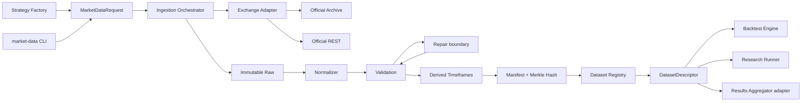
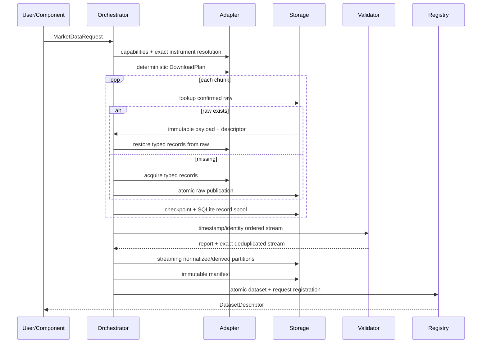
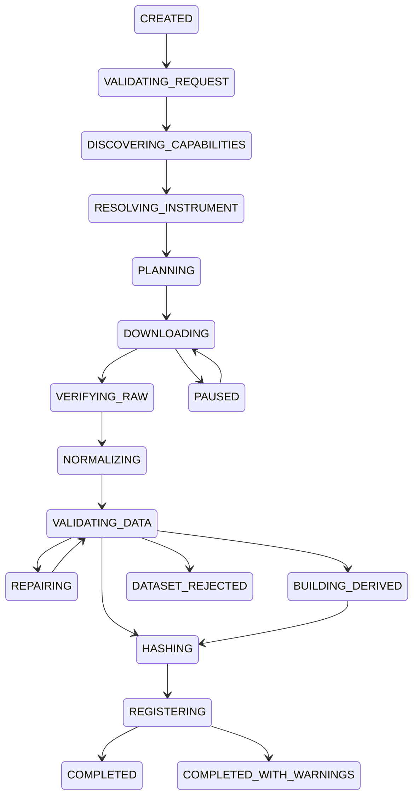
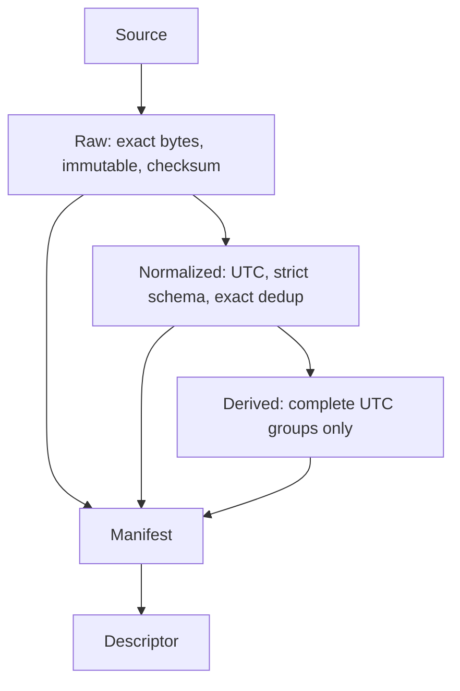

# Historical Market Data Ingestion architecture

## Repository audit result

The canonical integration surface is the staged v0.6 integration branch, while frozen
Core 0.4.2 remains authoritative for generic contracts. Existing Core `Candle` is a
consumer-facing completed OHLCV bar, not a raw acquisition schema. Existing Backtest
Engine data loading is retained as a consumer boundary. Results Aggregator already owns
an experiment/results registry and a narrower dataset-record schema; this component
therefore owns a detailed ingestion manifest and exposes an adapter to that existing
record rather than creating a second experiment registry.

The existing `scripts/pretest_support/dataset.py` validates a previously downloaded
`download_summary.csv` plus a BTCUSDT 5m file. It is safe to reuse as downstream
acceptance evidence but is not a resumable exchange downloader.

## Component diagram

## Download sequence

## State machine

## Data lifecycle

## Ownership rules

- Raw responses remain evidence and are never silently edited.
- Exact duplicates may be removed from normalized data only with retained evidence.
- Conflicting duplicates reject the dataset.
- Missing OHLCV is never interpolated.
- Registered versions are immutable.
- Consumers receive a descriptor and never cause a hidden update.

## Bounded-memory execution

Source adapters may materialize at most one configured chunk. The orchestrator writes
typed records to a strict SQLite spool, validates an ordered cursor in one pass, stages
accepted rows in bounded batches and streams monthly CSV publication. Derived OHLCV is
aggregated from the accepted ordered stream. Parquet remains a separate release gate
because `pyarrow` is not installed in the current environment.

## Version-preserving operations

`update`, `backfill` and `repair` publish a new immutable dataset version. Repair can:

- redownload a damaged normalized range;
- rebuild dependent OHLCV timeframes locally;
- restore metadata snapshots from raw exchange-info evidence;
- fill exact unresolved fixed-interval gaps for traded, mark, index, premium and
  open-interest streams.

Funding-rate events are not assigned a synthetic fixed cadence.
